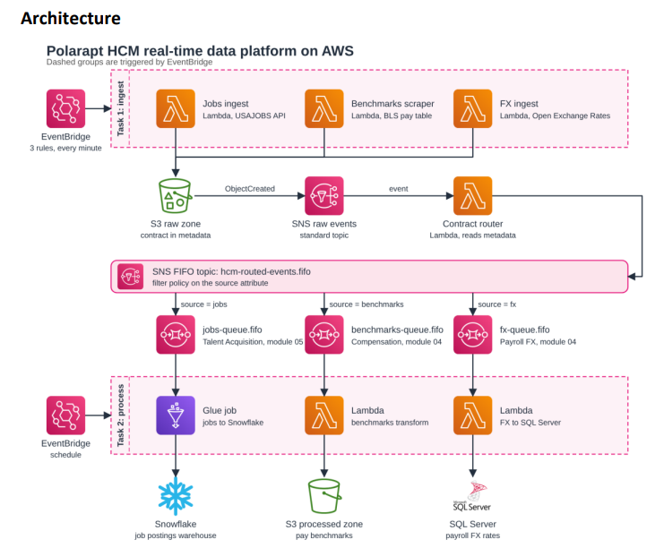
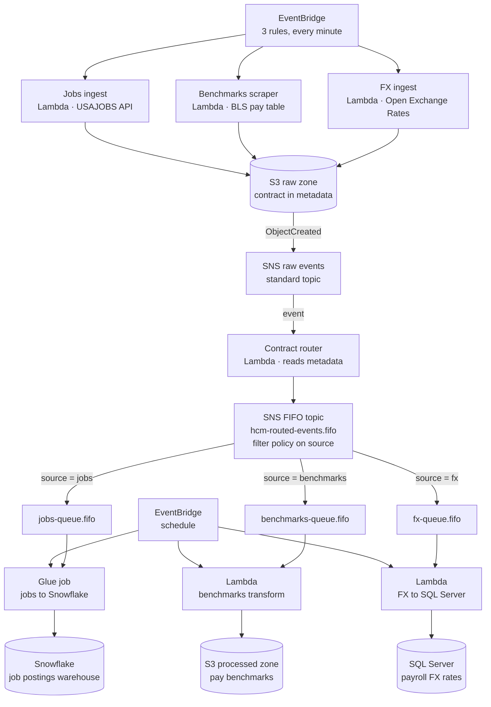

# Polarapt-HCM-Real-Time-Data-Platform-Data-Engineering-Hackathon

  
  
  
  
  
  
  
  

<h1 align="center">Polarapt HCM Real-Time Data Platform on AWS</h1>

  An event-driven data platform that ingests job postings, pay benchmarks, and FX rates
  every minute, routes each record to the right HCM domain through SNS FIFO fan-out, and
  lands it in the store that fits the use case: <b>Snowflake</b>, <b>S3</b>, or
  <b>SQL Server</b>.

  
  
  
  

---

## Table of Contents

- [Overview](#overview)
- [Architecture](#architecture)
- [How It Works](#how-it-works)
- [Data Sources](#data-sources)
- [Routing & HCM Domains](#routing--hcm-domains)
- [Components](#components)
- [Design Decisions](#design-decisions)
- [Tech Stack](#tech-stack)
- [IAM & Permissions](#iam--permissions)
- [Setup](#setup)
- [Monitoring & Reliability](#monitoring--reliability)
- [Roadmap](#roadmap)
---

## Overview

Polarapt's HCM (Human Capital Management) modules each need different external data:
Talent Acquisition needs fresh job postings, Compensation needs pay benchmarks, and
Payroll needs current FX rates. This platform pulls all three on a one-minute cadence,
stores every payload in a raw S3 zone, and uses a **contract carried in S3 object
metadata** to route each object to the correct domain queue. Each domain then
processes its data on its own schedule and loads it into its own target system.

The pipeline has two stages, both triggered by EventBridge:

| Stage | Trigger | Purpose |
|---|---|---|
| **Task 1: Ingest** | 3 EventBridge rules, every minute | Pull data from external APIs into the S3 raw zone |
| **Task 2: Process** | EventBridge schedule | Drain each domain queue and load the target store |

## Architecture

  

## How It Works

### Task 1: Ingest
1. Three **EventBridge** rules fire every minute, one per source.
2. Each rule triggers its own ingest **Lambda**: Jobs ingest, Benchmarks scraper, or FX ingest.
3. Every Lambda writes its payload to the **S3 raw zone**, attaching the routing **contract in the object's metadata**.

### Routing
4. S3 emits an `ObjectCreated` event to the **SNS raw events** topic (standard topic).
5. The **Contract router** Lambda receives the event and reads the object's metadata.
6. The router publishes to the **SNS FIFO topic** `hcm-routed-events.fifo`, setting the `source` message attribute.
7. A **filter policy on the `source` attribute** delivers each message only to its matching FIFO queue.

### Task 2: Process
8. An **EventBridge schedule** triggers the processing stage for each domain.
9. Each consumer drains its queue and loads the target store:
   - **jobs** → Glue job → **Snowflake**
   - **benchmarks** → Lambda transform → **S3 processed zone**
   - **fx** → Lambda → **SQL Server**

## Data Sources

| Source | Ingest Lambda | External system | Cadence |
|---|---|---|---|
| Job postings | Jobs ingest | USAJOBS API | Every minute |
| Pay benchmarks | Benchmarks scraper | BLS pay table | Every minute |
| FX rates | FX ingest | Open Exchange Rates | Every minute |

## Routing & HCM Domains

| `source` | Queue | HCM domain | Consumer | Target |
|---|---|---|---|---|
| `jobs` | `jobs-queue.fifo` | Talent Acquisition (module 05) | Glue job: jobs to Snowflake | Snowflake: job postings warehouse |
| `benchmarks` | `benchmarks-queue.fifo` | Compensation (module 04) | Lambda: benchmarks transform | S3 processed zone: pay benchmarks |
| `fx` | `fx-queue.fifo` | Payroll FX (module 04) | Lambda: FX to SQL Server | SQL Server: payroll FX rates |

## Components

| Component | Type | Role |
|---|---|---|
| EventBridge (ingest) | 3 rules, every minute | Triggers the three ingest Lambdas |
| Jobs ingest | Lambda | Pulls postings from the USAJOBS API |
| Benchmarks scraper | Lambda | Scrapes the BLS pay table |
| FX ingest | Lambda | Pulls rates from Open Exchange Rates |
| S3 raw zone | S3 | Stores raw payloads; routing contract in object metadata |
| SNS raw events | SNS standard topic | Fans out `ObjectCreated` events |
| Contract router | Lambda | Reads object metadata and republishes with a `source` attribute |
| `hcm-routed-events.fifo` | SNS FIFO topic | Routes by filter policy on `source` |
| `jobs-queue.fifo` | SQS FIFO | Buffers events for Talent Acquisition |
| `benchmarks-queue.fifo` | SQS FIFO | Buffers events for Compensation |
| `fx-queue.fifo` | SQS FIFO | Buffers events for Payroll FX |
| EventBridge (process) | Schedule | Triggers the processing stage |
| Glue job | AWS Glue | Loads jobs data into Snowflake |
| Benchmarks transform | Lambda | Transforms benchmarks into the processed zone |
| FX to SQL Server | Lambda | Loads FX rates into SQL Server |

## Design Decisions

- **Contract in metadata.** Routing information travels with each object in S3 metadata, so the router needs no lookup table and new sources can be added without changing the ingest-to-router path.
- **Two-hop fan-out.** A standard SNS topic handles raw S3 events; a FIFO topic handles routed events, where ordering and deduplication matter.
- **Filter policies, not code.** The `source` attribute and subscription filter policies decide which queue receives a message, keeping routing declarative.
- **One queue per domain.** Talent Acquisition, Compensation, and Payroll FX consume independently, so a slow or failing consumer does not block the others.
- **Right store per domain.** Job postings go to a Snowflake warehouse, benchmarks to an S3 processed zone, and FX rates to SQL Server for payroll.
- **Decoupled stages.** Ingest runs every minute; processing runs on its own schedule, with the queues absorbing the difference.

## Tech Stack

| Concern | Technology |
|---|---|
| Scheduling & triggers | Amazon EventBridge |
| Ingest & routing compute | AWS Lambda |
| Raw and processed storage | Amazon S3 |
| Messaging | Amazon SNS (standard and FIFO), Amazon SQS FIFO |
| Batch processing | AWS Glue |
| Warehouses & databases | Snowflake, Microsoft SQL Server |
| External data | USAJOBS API, BLS pay table, Open Exchange Rates |

## IAM & Permissions

Apply least privilege per role. Typical permissions for this design:

| Role | Permission | Purpose |
|---|---|---|
| EventBridge | `lambda:InvokeFunction`, `glue:StartJobRun` | Trigger ingest Lambdas and processing tasks |
| Ingest Lambdas | `s3:PutObject` | Write raw payloads with metadata |
| S3 → SNS | SNS topic policy allowing S3 to publish | Deliver `ObjectCreated` events |
| Contract router | `s3:GetObject`, `sns:Publish` | Read object metadata, publish to the FIFO topic |
| FIFO topic → queues | SQS queue policy allowing the topic to send | Deliver filtered messages |
| Consumers | `sqs:ReceiveMessage`, `sqs:DeleteMessage`, `sqs:GetQueueAttributes` | Drain domain queues |
| Benchmarks transform | `s3:PutObject` (processed zone) | Write pay benchmarks |
| Secrets (recommended) | `secretsmanager:GetSecretValue` | API keys and database credentials |
| Logging | `logs:CreateLogGroup`, `logs:PutLogEvents` | CloudWatch logs |

## Setup

1. **Create the S3 buckets or prefixes** for the raw and processed zones.
2. **Create the SNS standard topic** and configure S3 `ObjectCreated` notifications to publish to it.
3. **Create the SNS FIFO topic** `hcm-routed-events.fifo` and the three FIFO queues, subscribing each queue with a filter policy on `source` (`jobs`, `benchmarks`, `fx`).
4. **Deploy the Lambdas**: the three ingest functions, the contract router, the benchmarks transform, and the FX loader.
5. **Create the Glue job** that loads jobs data into Snowflake.
6. **Store credentials** (USAJOBS key, Open Exchange Rates app ID, Snowflake and SQL Server connections) in a secrets store.
7. **Create the EventBridge rules**: three one-minute rules for ingest, plus a schedule for the processing stage.
8. **Attach IAM roles** per the table above.
9. **Verify end to end**: confirm objects land in the raw zone, messages reach the right queue, and each target store receives data.

## Monitoring & Reliability

- Watch queue depth and age of oldest message on each FIFO queue to spot slow consumers.
- Alarm on Lambda errors and throttles, and on Glue job failures.
- Add dead-letter queues to the FIFO queues so poison messages do not block a domain.
- Track ingest freshness per source, since each source is expected every minute.

## Roadmap

- [ ] Define the whole platform as infrastructure as code (Terraform, AWS SAM, or CDK)
- [ ] Add dead-letter queues and a replay tool
- [ ] Add CloudWatch dashboards for freshness, queue depth, and error rates
- [ ] Add data quality checks before loading Snowflake and SQL Server
- [ ] Onboard additional HCM data sources through the same metadata contract

---

  Built with EventBridge · Lambda · S3 · SNS · SQS · Glue · Snowflake · SQL Server

